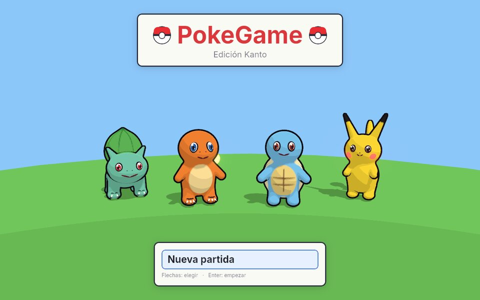
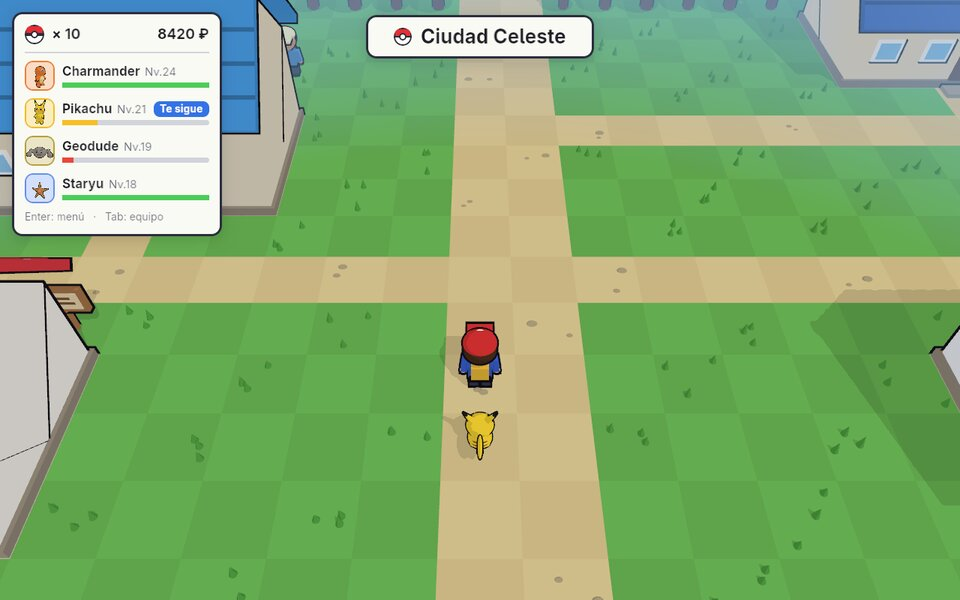
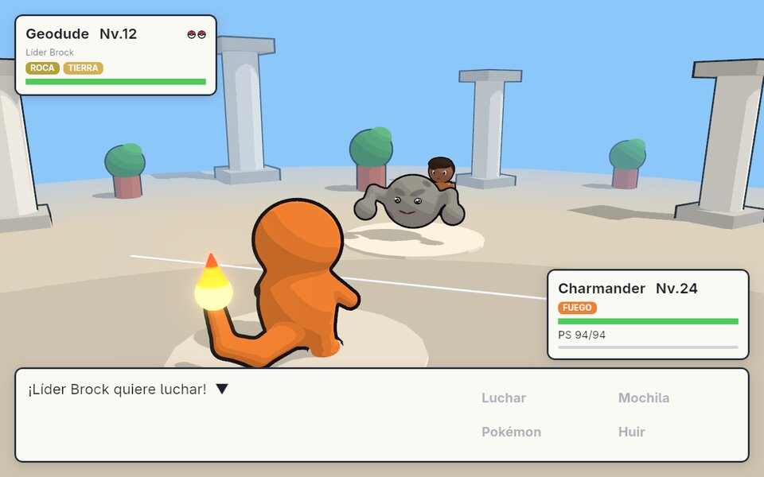
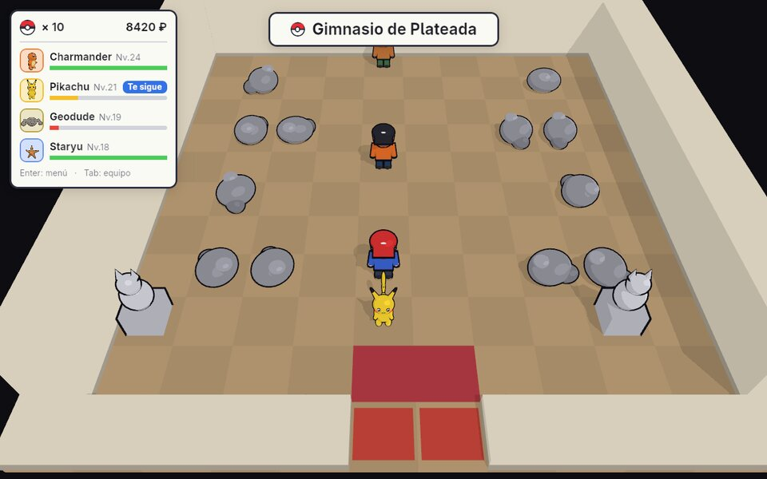
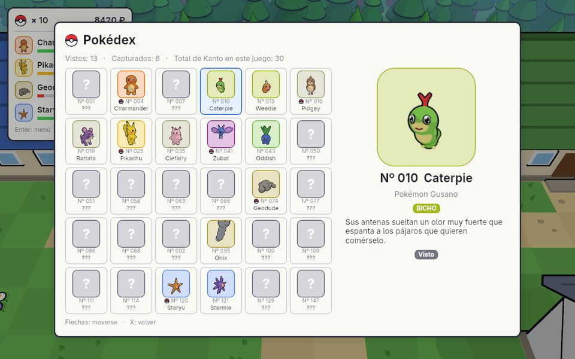
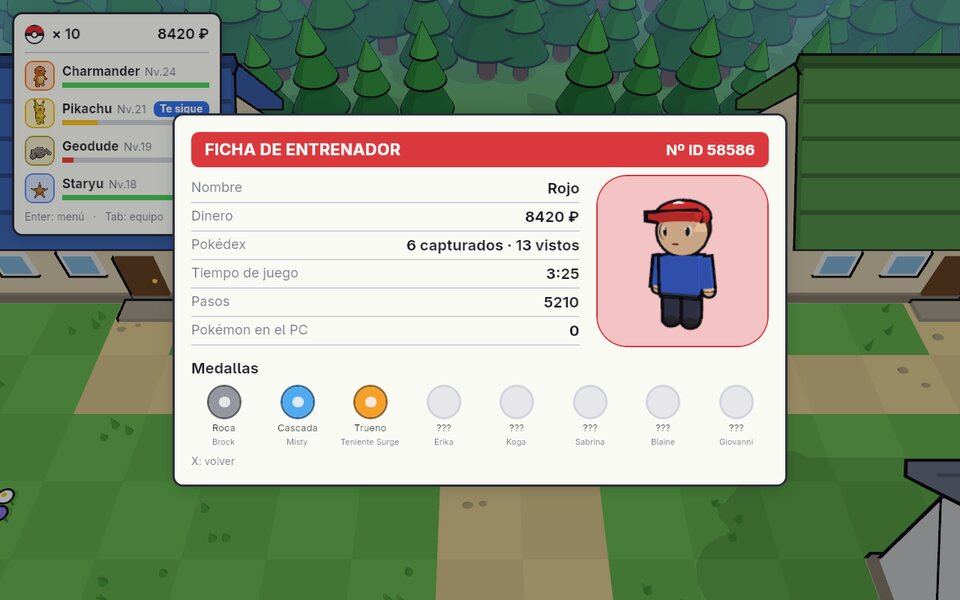
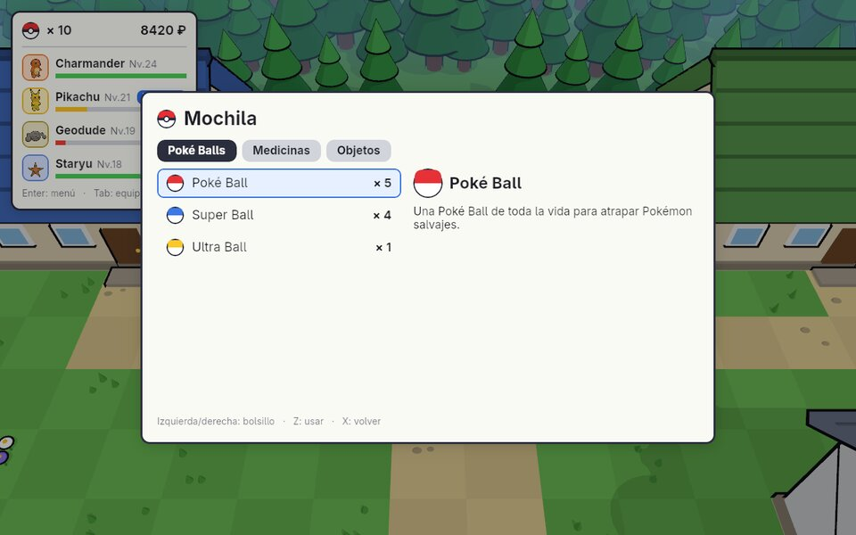
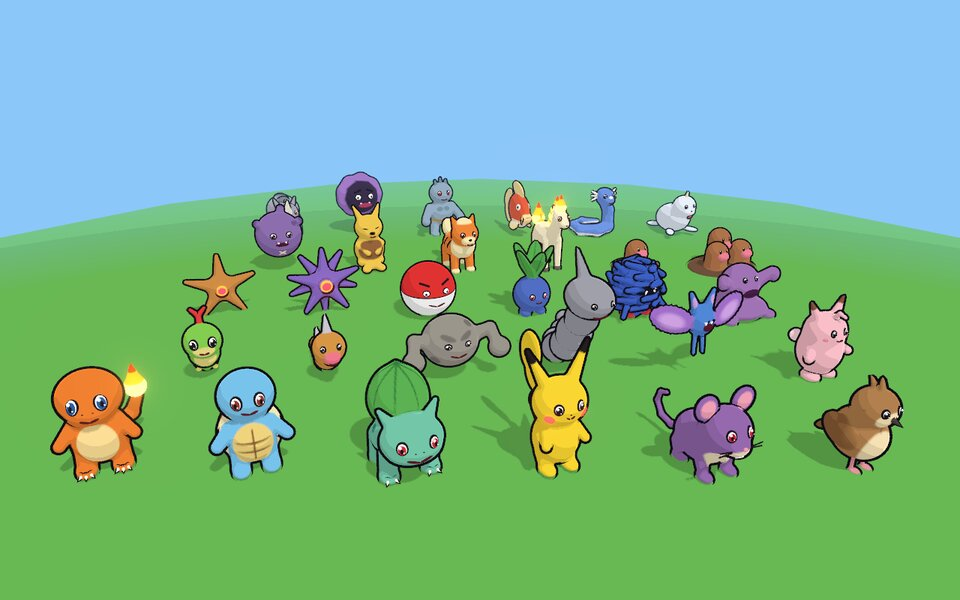

# PokeGame — Edición Kanto

Un juego de Pokémon en 3D hecho desde cero con [Bevy](https://bevyengine.org/) (Rust). Recorre Kanto
como en Pokémon Rojo: 10 ciudades, las rutas 1 a 25, cuevas, los 8 gimnasios y la Liga Pokémon,
con tu Pokémon siguiéndote por el mapa.

Todo lo que se ve está hecho en código: los 30 Pokémon están esculpidos con campos de distancia
(SDF), el mundo se construye a partir de mapas de texto y la interfaz se dibuja con nodos de UI.
No usa modelos, texturas ni mapas sacados de los juegos originales.



| | |
|---|---|
|  |  |
|  |  |
|  |  |



## Cómo jugar

```sh
cargo run --release
```

La primera compilación tarda unos minutos (Bevy es grande); las siguientes son rápidas.
En modo desarrollo (`cargo run`) también va fluido: las dependencias se compilan optimizadas.

**Requisitos:** Rust 1.85 o superior (edición 2024). En Linux, las librerías de sistema que pide
Bevy (`alsa-lib`, `libudev`, Vulkan/Mesa); en Arch: `pacman -S alsa-lib systemd-libs vulkan-icd-loader`,
en Debian/Ubuntu: `apt install libasound2-dev libudev-dev`.

### Controles

| Tecla | Acción |
|---|---|
| Flechas / WASD | Andar (un toque corto solo gira) |
| Shift | Correr |
| Z / Espacio | Hablar, leer carteles, recoger objetos, entrar por puertas |
| Enter / Esc | Menú: Pokédex, Pokémon, Mochila, Perfil, Guardar |
| Tab | Equipo: quién te sigue y quién sale primero |
| X | Volver / cancelar |
| Q / E, botón derecho del ratón | Girar la cámara |
| Rueda / + − | Acercar y alejar |
| R | Cámara como al principio |

Las flechas son relativas a la cámara: "arriba" es siempre hacia el fondo de la pantalla.

## Qué hay

- **Kanto completo**: Pueblo Paleta, Ciudad Verde, Plateada, Celeste, Carmín, Lavanda, Azulona,
  Fucsia, Azafrán, Isla Canela y la Meseta Añil; las rutas 1–25 (Puente Pepita, Camino de Bicis,
  rutas de mar...); Bosque Verde, Mt. Moon, Cueva Diglett, Túnel Roca, Islas Espuma y Calle
  Victoria; Torre Pokémon, Zona Safari, Silph S.A., Casino, Mansión Pokémon, Dojo y Museo.
- **Avance en orden**: cada zona y cada gimnasio pide las medallas que tocan (Brock, Misty,
  Surge, Erika, Koga, Sabrina, Blaine, Giovanni); si no las tienes, un guardia te para.
- **Entrenadores** que te ven, se acercan y te retan; **líderes** con su medalla; el **Alto
  Mando** y el **Campeón**.
- **30 especies** con los 15 tipos de la 1.ª generación, tipos dobles, evoluciones y Pokédex.
- **Combates** con Luchar / Mochila / Pokémon / Huir, objetos, capturas (PC si el equipo está
  lleno), dinero y experiencia.
- **Mochila y tienda**: Poké/Super/Ultra/Master Ball, pociones, Revivir, Repelente, Cuerda Huida,
  Caramelo Raro; la tienda vende más cosas cuantas más medallas tengas.
- **Surf** con la Medalla Alma y un Pokémon de tipo Agua.
- **Ficha de entrenador** con medallas, dinero, tiempo y Pokédex, y **partida guardada**.
- Personaje con piernas y brazos articulados, movimiento a velocidad constante y cámara suave.

## Cómo está organizado

```
src/
├── main.rs              Arranque: ventana, luces, cámara principal, estados del juego
├── battle.rs            Combates (salvajes y entrenadores), su interfaz y la arena 3D
├── game/                El estado de la partida
│   ├── items.rs         Objetos, bolsillos de la mochila y lo que vende cada tienda
│   ├── progress.rs      Dinero, medallas, Pokédex, entrenadores vencidos, objetos recogidos...
│   └── save.rs          Partida guardada (formato binario, ver abajo)
├── pokemon/             Los Pokémon
│   ├── mod.rs           Tipos, ataques, especies y Pokémon concretos (nivel, PS, experiencia)
│   ├── sculpt.rs        Cómo es cada especie: su escultura SDF, ojos, boca y detalles
│   └── sdf.rs           Escultura con campos de distancia y mallado con surface nets
├── world/               El mundo
│   ├── mod.rs           Casillas, edificios, salidas y carga de mapas de texto
│   ├── kanto.rs         Los 64 mapas de Kanto con su gente, objetos y Pokémon salvajes
│   ├── npcs.rs          Personas: entrenadores, líderes, enfermera, tienda, guardias, medallas
│   └── overworld.rs     Construir el mapa en 3D, andar, hablar, puertas y cambios de mapa
├── render/              Lo que se dibuja
│   ├── models.rs        Materiales toon, contornos y todos los modelos del escenario y personajes
│   ├── portraits.rs     Retratos 3D en vivo para la interfaz (equipo, Pokédex, ficha)
│   └── camera.rs        Cámara orbital y controles relativos a la cámara
├── ui/                  La interfaz
│   ├── mod.rs           Piezas comunes: paneles, textos, barras, Poké Ball, medallas
│   ├── dialog.rs        Cuadro de diálogo, preguntas y acciones al terminar
│   ├── party.rs         Recuadro del equipo y menú de equipo (Tab)
│   ├── menu.rs          Menú de juego, Pokédex, mochila, ficha, guardar y tienda
│   └── title.rs         Pantalla de título (Continuar / Nueva partida)
└── dev/
    └── snapshot.rs      Capturas sin ventana para comprobar escenas (ver abajo)

assets/
├── fonts/               Adwaita Sans (licencia OFL, incluida)
└── shaders/toon.wesl    Sombreado cel (bandas de luz + luz de borde)

docs/capturas/           Imágenes de este README
```

## Cómo funciona

### Los Pokémon

Cada especie es una suma suave de elipsoides y "conos redondeados" (como modelar con arcilla),
más capas de pintura para barrigas, manchas y rayas (`pokemon/sdf.rs`). Al arrancar se convierte
en malla con *surface nets*, en paralelo (un hilo por especie). Los ojos, bocas, garras y llamas
se pegan a la superficie lanzando rayos contra la escultura. Se dibujan con sombreado cel
(`assets/shaders/toon.wesl`) y un contorno negro por "casco invertido".

### Los mapas

Cada mapa es un dibujo de texto en `world/kanto.rs`:

```
#  árbol / pared        g  hierba alta       .  suelo          :  camino
~  agua                 =  puente            f  flores         F  valla
r  roca                 b  arbusto           s  cartel         M  montaña
v  saliente             o  objeto            *  persona        U  estatua
h c m G l B  casa, Centro, Tienda, Gimnasio, laboratorio, edificio grande
C S T K P x  mostrador, estantería, mesa, planta, máquina, alfombra
0-9  salidas (cada una dice a qué mapa y salida lleva)
```

Las personas, carteles y objetos se emparejan con sus datos en orden de lectura. Los tests
comprueban que todos los mapas son rectangulares, que cada salida tiene su vuelta, que nadie
está sobre un obstáculo, que todo Kanto es alcanzable y que las medallas lo abren en orden.

### La partida guardada

`game/save.rs` escribe un archivo binario de un centenar de bytes:

- cabecera `PKGM`, versión y longitud, y un **CRC-32** al final para detectar archivos dañados;
- números como enteros de longitud variable (LEB128): casi todos ocupan 1 o 2 bytes;
- banderas (entrenadores vencidos, objetos recogidos, Pokédex) como bits;
- escritura **atómica** (archivo temporal + `fsync` + renombrar) en un hilo aparte, así que
  el juego no se congela y un corte de luz nunca estropea la partida anterior.

Se guarda en `~/.local/share/pokegame/partida.sav` (o en `$POKEGAME_SAVE`).

## Desarrollo

```sh
cargo test        # mapas, tipos, guardado, mallas de los Pokémon, caracteres de la fuente...
```

### Capturas sin ventana

`dev/snapshot.rs` renderiza una escena fuera de pantalla, la guarda como PNG y sale. Sirve para
comprobar cambios visuales sin abrir el juego:

```sh
POKEGAME_SNAPSHOT=dex:dex.png cargo run
```

Escenas: `title`, `overworld`, `menu`, `start`, `bag`, `profile`, `dex`, `save`, `shop`, `quiz`,
`battle`, `trainer`, `gallery`, `gallery-back` y `p<especie>a<grados>` (primer plano de un
Pokémon). Otras variables:

| Variable | Para qué |
|---|---|
| `POKEGAME_MAP=<n>` | Empezar en ese mapa |
| `POKEGAME_PLACE=<mapa>,<x>,<y>` | Empezar en esa casilla |
| `POKEGAME_KEYS=up*20,enter,z` | Simular teclas (`*n` = mantener n fotogramas, `wait*n` = esperar) |
| `POKEGAME_FRAMES=<n>` | Fotograma en el que se hace la captura |
| `POKEGAME_WILD=<especie>` | Pokémon salvaje del combate |
| `POKEGAME_TRAINER=<mapa>:<n>` | Entrenador del combate |
| `POKEGAME_BADGES=<bits>` | Medallas de la partida de prueba |
| `POKEGAME_TRACE=<archivo>` | Posición del jugador y la cámara en cada fotograma |
| `POKEGAME_SAVE=<archivo>` | Dónde guardar la partida |

## Aviso

Proyecto de aficionado sin ánimo de lucro, sin relación con Nintendo, Game Freak ni The Pokémon
Company. Pokémon y los nombres de sus personajes son marcas de sus respectivos dueños. Todos los
modelos, mapas e interfaz de este repositorio están hechos desde cero.
